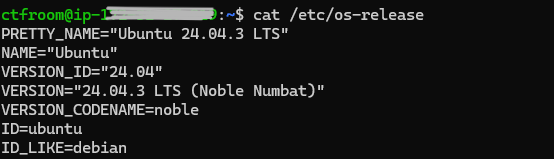
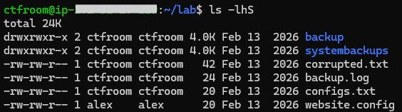
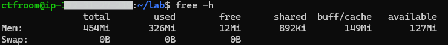
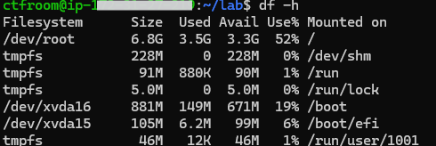
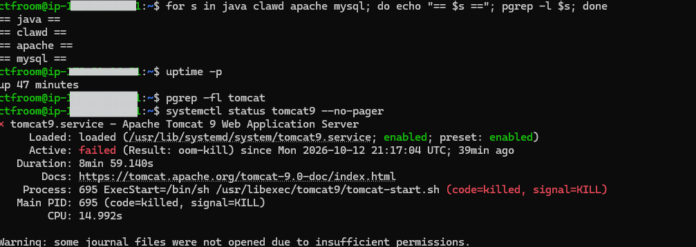

# Linux Server Administration Baseline Lab

## Scenario
I was given SSH access to a Linux server as a new system administrator. Before making any changes, the goal was to build a baseline of the system: its identity, filesystem, resources and running processes.

## Environment
- OS: Ubuntu 24.04.3 LTS (GNU/Linux 6.14.0-1010-aws x86_64)
- Hosting: AWS cloud instance
- Access method: SSH from Windows
- Tools: terminal (whoami, hostname, pwd, ls, cat, free, df, ps)

## What I did
1. Connected to the server over SSH with `ssh ctfroom@<lab-ip>`.
   - `ssh` opens a secure remote terminal session on another machine.
2. Identified the operating system with `cat /etc/os-release`.
   - `cat` prints a file. `/etc/os-release` is where Linux stores its OS name and version.
   - Result: Ubuntu 24.04.3 LTS (Noble Numbat), Debian-based.
3. Moved into the lab workspace with `cd lab`.
   - `cd` means "change directory".
4. Listed the workspace with `ls`, then `ls -a` to check for hidden files.
   - `-a` shows files whose names start with a dot.
   - Result: 6 items, none hidden.
5. Checked file types, sizes and ownership with `ls -lh`.
   - `-l` is the long format and `-h` makes sizes human-readable.
   - Result: 4 regular files and 2 directories (`backup`, `systembackups`). `website.config` is owned by a different user (`alex`).
6. Sorted by size with `ls -lhS` to find the largest file.
   - `-S` sorts largest first. Directories show a fixed 4.0K, so I compared the regular files only.
   - Result: `corrupted.txt` (42 bytes) is the largest file.
7. Checked memory with `free -h`.
   - `free` shows RAM usage.
   - Result: 454 MiB total, 326 MiB used, 127 MiB available, no swap.
8. Checked disk capacity with `df -h`.
   - `df` means "disk free" and shows each filesystem's size and usage.
   - Result: the root filesystem is 6.8 GB, 52% used.
9. Checked which expected services were running with `pgrep -l <name>` for Java, clawd, Apache and MySQL.
   - `pgrep` searches running processes by name. `-l` prints the name beside the process ID.
   - Only `java` was found (PID 695). I re-checked with `pgrep -fl` and `ps aux | grep -i clawd | grep -v grep`, which search full command lines, and confirmed clawd was not running.
   - `pgrep -fl apache` matched the Java process, so I inspected it with `ps -o args= -p 695`. It was Apache Tomcat 9 (the path pointed to `/var/lib/tomcat9`), so "apache" matched inside its command line, not a separate Apache web server.
   - Result: clawd, Apache and MySQL were not running. Java (Tomcat) was.
   - Note: when I repeated this check later in the session, Tomcat was no longer running (see finding 5).

## What I found
### 1. System identity

Confirms Ubuntu 24.04.3 LTS (Noble Numbat) via `/etc/os-release`. `ID_LIKE=debian` shows it is Debian-based.
### 2. Workspace contents

Sorted with ls -lhS. Directories show a fixed 4.0K, so the largest file is corrupted.txt (42 bytes). website.config is owned by a different user.
### 3. Memory

454 MiB RAM, 326 MiB used, 127 MiB available, no swap. A small instance with limited headroom.
### 4. Disk

The root filesystem is 6.8 GB, 52% used. tmpfs entries are RAM-backed, so they don't count as disk.
### 5. Service failure

Tomcat 9 (PID 695) was running during my first check but had failed by a later one, with Result: oom-kill. The server has about 454 MiB of RAM and no swap, which is consistent with memory exhaustion.

## Problems and how I fixed them
### 1. Counting files in the workspace
- **Problem:** `ls` showed 6 items, but my first count of "files" was marked wrong.
- **Fix:** I ran `ls -l` and looked at the first character of each line. `d` means a directory and `-` means a regular file, so two of the six items (`backup` and `systembackups`) were directories. That left 4 regular files, but the accepted answer was 3. It left out `website.config`, which is owned by a different user (`alex`), so the expected count seems to have included only files owned by my account.
- **Lesson:** the raw output and the expected answer can differ, so I recorded both. Check types and ownership with `ls -l` before counting.

### 2. Finding the largest file
- **Problem:** the two directories appeared at the top of `ls -lhS` because they show a fixed 4.0K size, regardless of what's inside.
- **Fix:** I compared only the regular files, which showed that `corrupted.txt` (42 bytes) was the largest.
- **Lesson:** a directory's displayed size doesn't reflect its contents.

### 3. A name search suggested Apache was running
- **Problem:** `pgrep` by name found only `java`, but searching the full command line (`pgrep -f apache`) also matched the Java process.
- **Fix:** I inspected process 695 with `ps -o args= -p 695`. The path pointed to `/var/lib/tomcat9`, so it was Apache Tomcat, a Java application server, and "apache" was a text match, not a separate Apache web server. I also noticed that `grep` matches its own command line, so I used `grep -v grep` and `pgrep` to avoid being misled.
- **Lesson:** a matching word doesn't prove a service is running. Check the full command line.

### 4. The Java service was gone on a later check
- **Problem:** when I repeated the process check later, nothing showed for `java`, although Tomcat had been running earlier.
- **Fix:** I checked `uptime -p` and `systemctl status tomcat9`. The service had failed with `Result: oom-kill`, meaning the kernel stopped it for running out of memory. That fits the server's 454 MiB of RAM and no swap. I did not restart anything, because the lab only asked me to observe.
- **Lesson:** server state changes over time, so a result is only true at the moment you check it. Record what you saw and when.

## What I learned
(2-3 lines)
