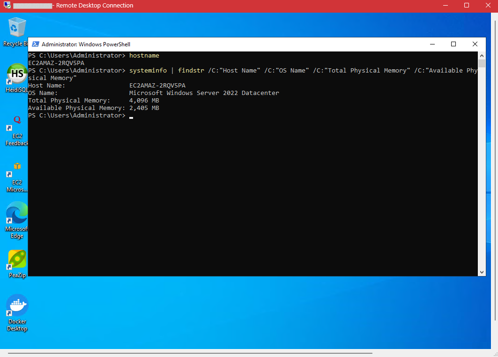
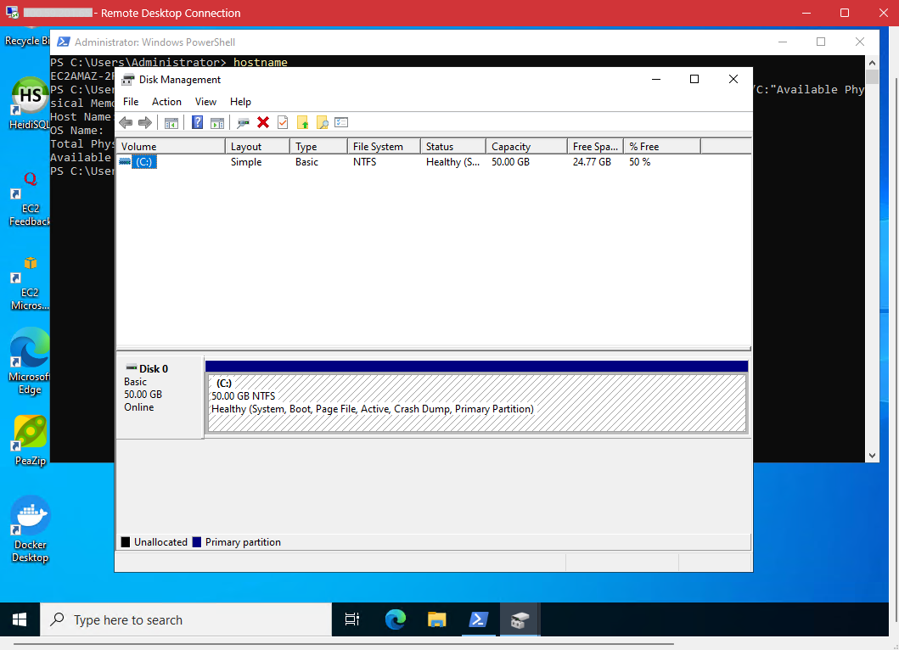
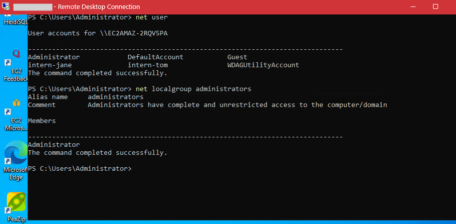
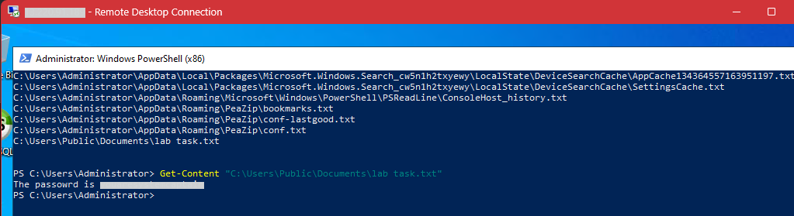
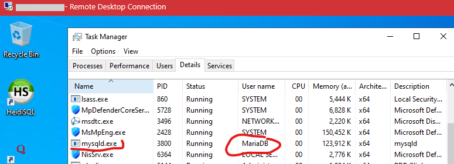

# Windows Server Administration Baseline Lab

## Scenario
I was given RDP access to a Windows Server running a live workload. Before changing anything, I had to find out who can log in, who has admin rights, what the server is, how much RAM and disk it has, what was installed, and which account runs the database.

## Environment
- OS: Windows Server 2022 Datacenter (build 20348), AWS instance
- Access method: RDP
- Tools: PowerShell, Task Manager, Disk Management, Computer Management

## What I did
1. Connected over RDP with `mstsc`, using the Administrator account.
2. Checked the server name and OS with `hostname` and `systeminfo`. It is `ec2amaz-2rqv5pa` running Windows Server 2022 Datacenter with 4 GB of RAM.
3. Checked disk size in Disk Management. The C: drive is 50 GB with 24.77 GB free.
4. Listed accounts with `net user` and admin rights with `net localgroup administrators`. Only Administrator is an admin.
5. Listed the Downloads folder with `Get-ChildItem` and sorted it by `CreationTime` to see what was installed and when. I used `-Force` to include hidden files.
6. Searched `C:\Users` for `.txt` files and found a text file in the Documents folder with a password written in plain text. I read it with `Get-Content`.
7. Checked which account runs `mysqld.exe` in Task Manager (Processes and Services tabs), then confirmed it with `Get-Process mysqld -IncludeUserName` and `tasklist /v`.

## What I found
### 1. Server identity and capacity

The server is Windows Server 2022 Datacenter running on AWS, hostname `ec2amaz-2rqv5pa`. It has 4 GB of RAM, and about 2.4 GB was available when I checked.

The C: drive is 50 GB with 24.77 GB free, so about half is used.

### 2. Accounts and admin rights

`net user` showed 6 accounts. Three are built into Windows (DefaultAccount, Guest and WDAGUtilityAccount). The other three are in use: Administrator, intern-jane and intern-tom. Only Administrator has local admin rights. The two interns are standard users.

### 3. Plaintext password

I found a password written in plain text in a file in the Documents folder. The password is hidden in the screenshot. Anyone who can open that folder can read it, so in a real job I'd delete the file, change the password, and keep passwords in a password manager.

### 4. Database service account

In Task Manager I expanded the MySQL entry on the Processes tab and saw it was the MariaDB service. On the Services tab I found MariaDB running with its PID. PowerShell and `tasklist /v` both showed it runs as `NT SERVICE\MariaDB`, a service account made just for that service, which is what you want for a database.

## Problems and how I fixed them
(where I got stuck)

## What I learned
(summary)
